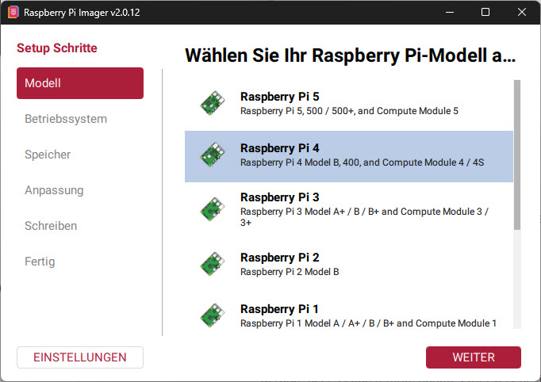
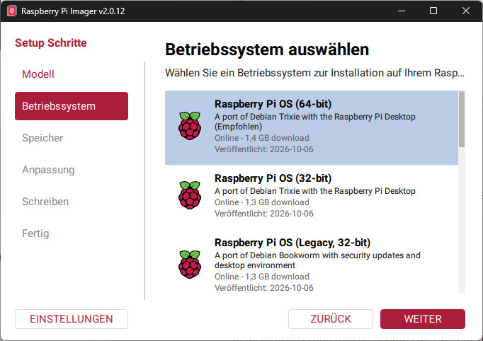
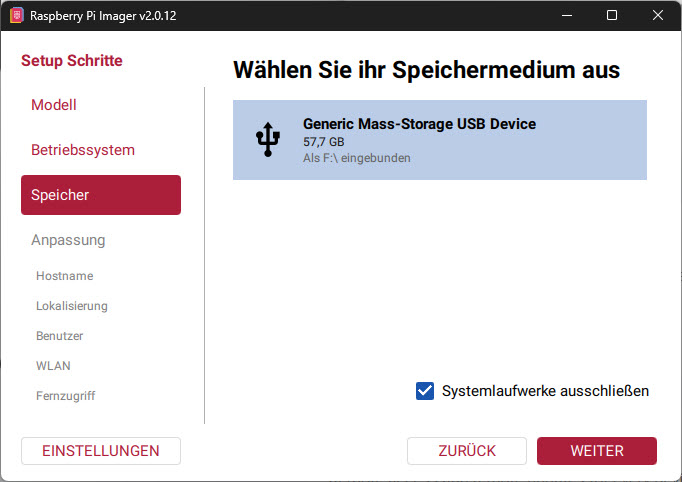
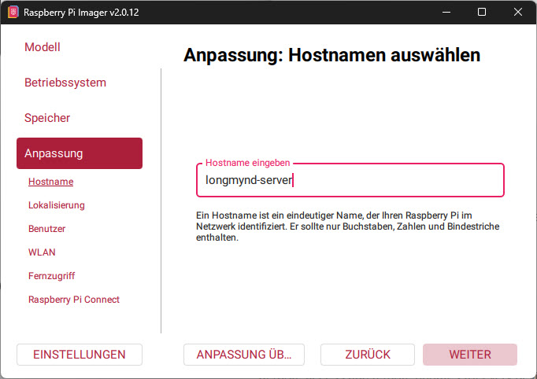
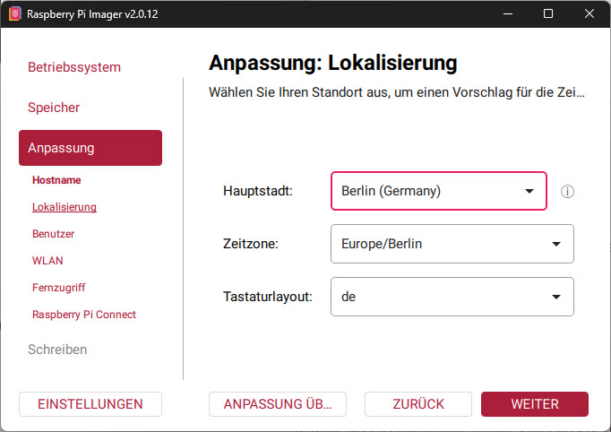
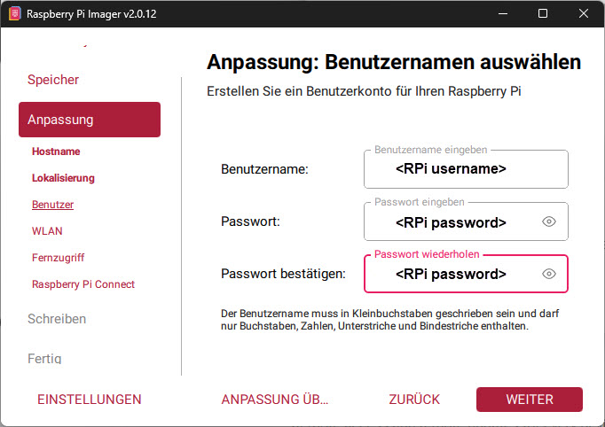
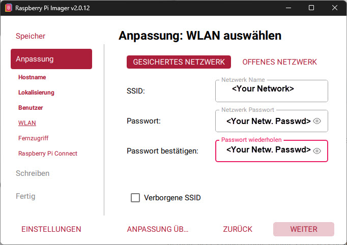
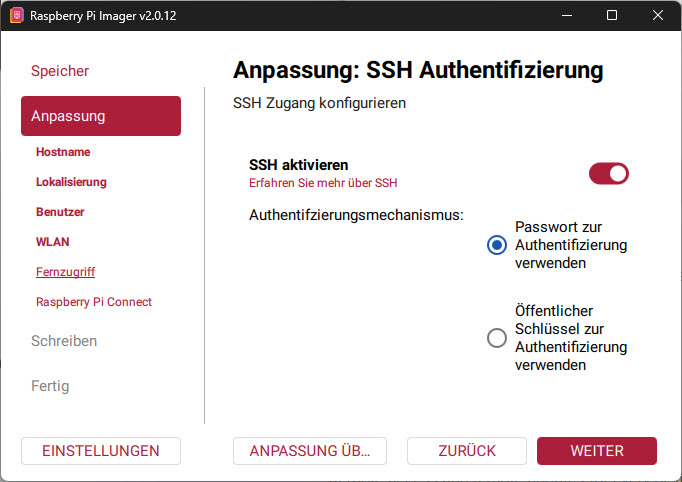

# 1. Raspberry-Pi-Image erstellen (Raspberry Pi Imager v2.0.12)

Mit dem Raspberry Pi Imager wird Raspberry Pi OS auf die SD-Karte geschrieben
und dabei Hostname, Benutzer, WLAN und SSH vorkonfiguriert. Danach läuft der
Pi ohne Bildschirm und Tastatur (headless). Weiter geht es mit
[HowTo_Install.md](HowTo_Install.md).

Stand: November 2026, Raspberry Pi Imager **v2.0.12** (Windows, deutsche
Oberfläche). Die Bezeichnungen in den Menüs können bei anderen Versionen
oder Sprachen abweichen.

## Voraussetzungen

- Raspberry Pi 4B (hier 4 GB), SD-Karte (mindestens 16 GB, besser Markenware),
  Kartenleser am PC
- Netzteil 5 V / 3 A
- LAN-Kabel (stabiler als WLAN) oder WLAN-Zugangsdaten
- Der Imager von https://www.raspberrypi.com/software/

## Ablauf im Imager

Die Seitenleiste zeigt die Schritte: **Modell**, **Betriebssystem**,
**Speicher**, **Anpassung** (Hostname, Lokalisierung, Benutzer, WLAN,
Fernzugriff, Raspberry Pi Connect), **Schreiben**, **Fertig**. Jede Seite
wird mit **WEITER** bestätigt.

### 1. Modell wählen

**Raspberry Pi 4** (gilt auch für Pi 400 und Compute Module 4).

### 2. Betriebssystem wählen

**Raspberry Pi OS (64-bit)** (als „Empfohlen" markiert). Für den Betrieb ohne
Bildschirm genügt auch die Lite-Variante, sie steht weiter unten in der
Liste unter den weiteren Raspberry-Pi-OS-Varianten.

### 3. Speicher wählen

Die SD-Karte im Kartenleser auswählen (hier ein USB-Kartenleser mit 57,7 GB,
eingebunden als `F:\`). Der Haken **Systemlaufwerke ausschließen** schützt
davor, versehentlich eine interne Platte zu wählen. Er sollte gesetzt
bleiben. **Der Inhalt der gewählten Karte wird gelöscht.**

### 4. Anpassung

Die Anpassung besteht aus mehreren Seiten. Werte für dieses Setup:

| Seite | Einstellung | Wert |
|---|---|---|
| Hostname | Hostname | `longmynd-server` |
| Lokalisierung | Hauptstadt / Zeitzone / Tastatur | Ihr Standort, hier Berlin, `Europe/Berlin`, `de` |
| Benutzer | Benutzername / Passwort | `<RPi username>` (in den Anleitungen als Beispiel `dh1rk`, bei eigenem Namen dort anpassen), Passwort frei wählen und notieren |
| WLAN | SSID / Passwort | `<Your Network>` / `<Your Netw. Passwd>`, nur falls kein LAN-Kabel genutzt wird |
| Fernzugriff | SSH aktivieren | **ein**, Authentifizierung mit **Passwort** |
| Raspberry Pi Connect | – | nicht nötig |

Der Benutzername muss kleingeschrieben sein und darf nur Buchstaben, Zahlen,
Unter- und Bindestriche enthalten. Der Hostname darf nur Buchstaben, Zahlen
und Bindestriche enthalten.

**Hostname**

**Lokalisierung**

**Benutzer** (Benutzername und Passwort, das Passwort wird zur Bestätigung
zweimal eingegeben)

**WLAN** (nur ohne LAN-Kabel): **GESICHERTES NETZWERK** für ein Netz mit
Passwort, **OFFENES NETZWERK** ohne Passwort. SSID (Netzwerk Name) und
Passwort eintragen und das Passwort bestätigen. **Verborgene SSID** ankreuzen,
wenn das Netz seinen Namen nicht aussendet.

**Fernzugriff: SSH aktivieren.** Ohne diese Freigabe ist der Pi nach dem
Start nicht erreichbar.

### 5. Schreiben und Fertig

Die Zusammenfassung bestätigen und warten, bis Schreiben und Überprüfen
fertig sind. Auf der Seite **Fertig** die SD-Karte auswerfen, in den Pi
stecken und das Netzteil anschließen. Der erste Start dauert 1 bis 2
Minuten.

## Häufige Fehler

- **Kein Zugriff nach dem Start:** Zuerst Kabel testen. Häufigster Fehler ist
  ein Tippfehler bei SSID oder Passwort.
- **SSH nicht aktiviert:** Ohne SSH-Freigabe im Imager ist der Pi nicht
  erreichbar. Karte neu schreiben und SSH aktivieren.
- **Falsche Karte gewählt:** Der Imager löscht den gewählten Datenträger.
  Prüfen Sie Namen und Größe.
- **„Legacy" im Betriebssystem:** Das bedeutet nur ein älteres Debian-Release
  (hier Bookworm statt Trixie), nicht 32 gegen 64 Bit. Wählen Sie das
  64-Bit-Image.

Anmeldung per SSH und alles Weitere: [HowTo_Install.md](HowTo_Install.md),
Abschnitt 2.
