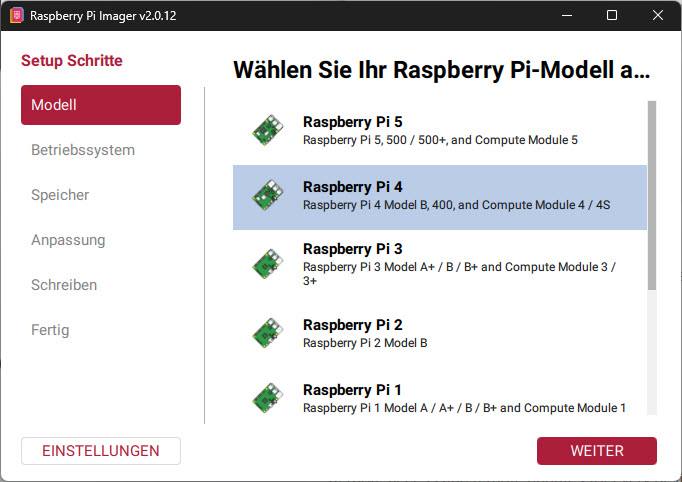
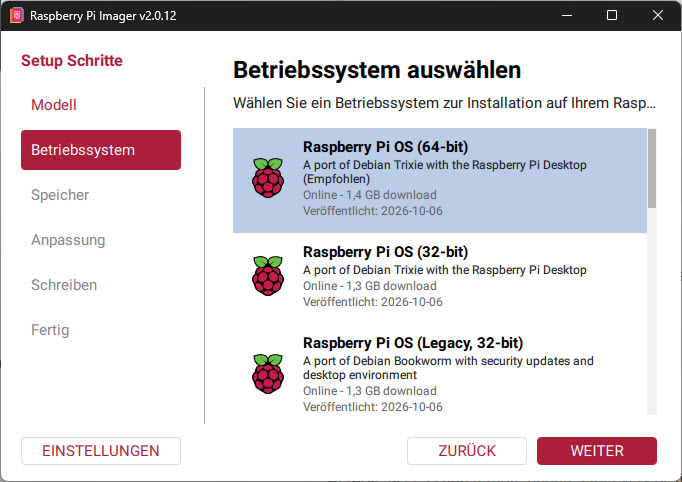
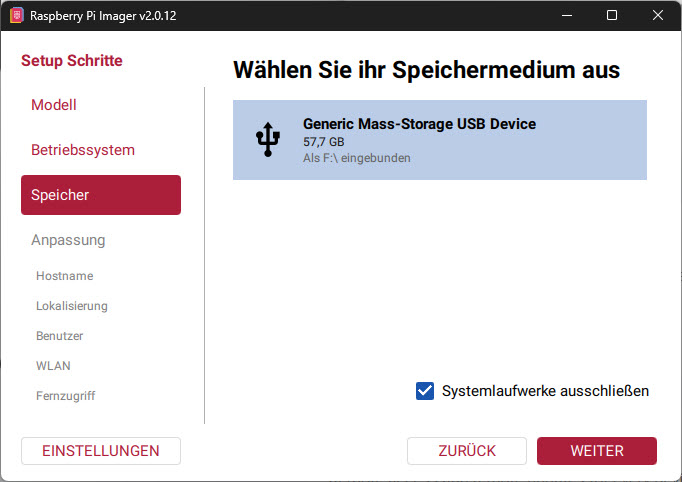
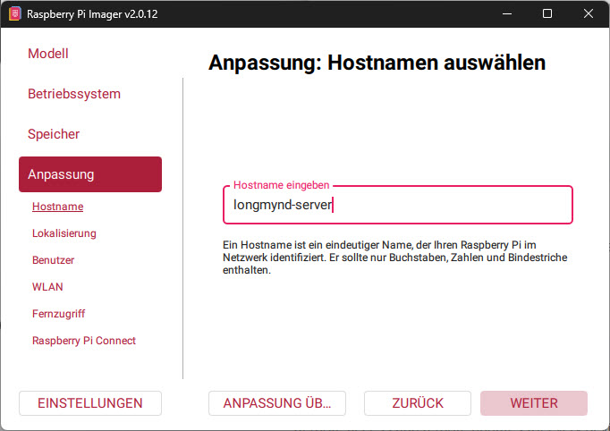
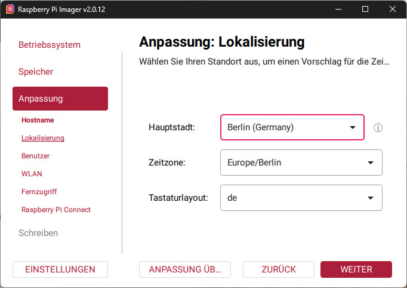
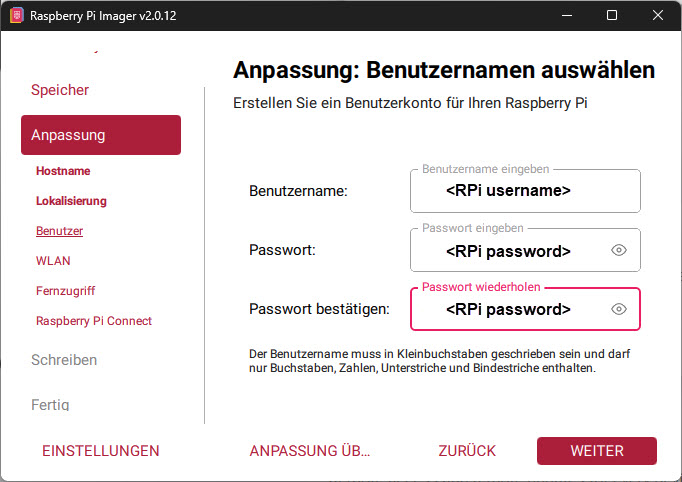
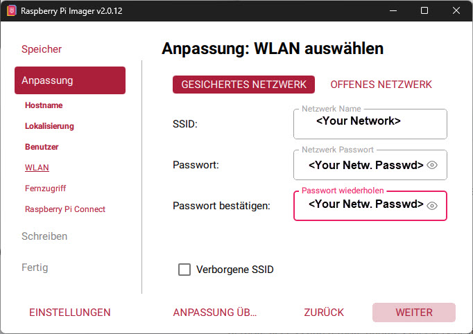
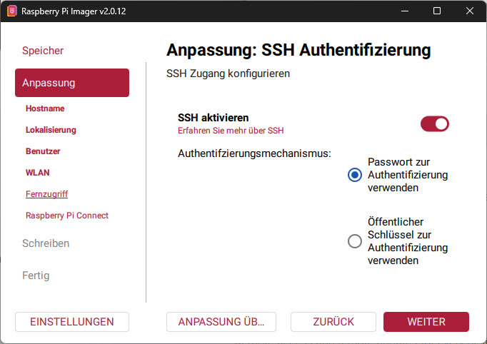

# 1. Create the Raspberry Pi image (Raspberry Pi Imager v2.0.12)

The Raspberry Pi Imager writes Raspberry Pi OS to the SD card and
pre-configures hostname, user, Wi-Fi and SSH. Afterwards the Pi runs without
screen and keyboard (headless). Continue with
[HowTo_Install_EN.md](HowTo_Install_EN.md).

Status: November 2026, Raspberry Pi Imager **v2.0.12** (Windows). The
screenshots show the German user interface, so the menu names are given in
English with the German label in parentheses. Names can differ in other
versions or languages.

## Prerequisites

- Raspberry Pi 4B (here 4 GB), SD card (at least 16 GB, preferably a branded
  one), card reader on the PC
- 5 V / 3 A power supply
- LAN cable (more stable than Wi-Fi) or Wi-Fi credentials
- The Imager from https://www.raspberrypi.com/software/

## Steps in the Imager

The sidebar shows the steps: **Model** (Modell), **Operating system**
(Betriebssystem), **Storage** (Speicher), **Customisation** (Anpassung:
Hostname, Localisation / Lokalisierung, User / Benutzer, Wi-Fi / WLAN,
Remote access / Fernzugriff, Raspberry Pi Connect), **Writing**
(Schreiben), **Done** (Fertig). Confirm each page with **NEXT**
(WEITER).

### 1. Choose the model

**Raspberry Pi 4** (also covers Pi 400 and Compute Module 4).

### 2. Choose the operating system

**Raspberry Pi OS (64-bit)** (marked "Recommended"). For operation without a
screen the Lite variant is sufficient too, it is further down in the list
under the other Raspberry Pi OS variants.

### 3. Choose the storage

Select the SD card in the card reader (here a USB card reader with 57.7 GB,
mounted as `F:\`). The checkbox **Exclude system drives**
(Systemlaufwerke ausschließen) protects against accidentally choosing an
internal disk. It should stay ticked. **The contents of the chosen card are
erased.**

### 4. Customisation

The customisation consists of several pages. Values for this setup:

| Page | Setting | Value |
|---|---|---|
| Hostname | Hostname | `longmynd-server` |
| Localisation | Capital / time zone / keyboard | your location, here Berlin, `Europe/Berlin`, `de` |
| User | Username / password | `<RPi username>` (the guides use `dh1rk` as an example, adjust it there if you choose your own name), choose a password and note it down |
| Wi-Fi | SSID / password | `<Your Network>` / `<Your Netw. Passwd>`, only if no LAN cable is used |
| Remote access | Enable SSH | **on**, authentication with **password** |
| Raspberry Pi Connect | – | not needed |

The username must be lowercase and may only contain letters, digits,
underscores and hyphens. The hostname may only contain letters, digits and
hyphens.

**Hostname**

**Localisation**

**User** (username and password, the password is entered twice for
confirmation)

**Wi-Fi** (only without a LAN cable): **SECURED NETWORK** (GESICHERTES
NETZWERK) for a network with a password, **OPEN NETWORK** (OFFENES NETZWERK)
without a password. Enter the SSID (network name) and password and confirm
the password. Tick **Hidden SSID** (Verborgene SSID) if the network does not
broadcast its name.

**Remote access: enable SSH.** Without this the Pi cannot be reached after
the start.

### 5. Writing and Done

Confirm the summary and wait until writing and verifying are finished. On the
**Done** page, eject the SD card, insert it into the Pi and connect the power
supply. The first boot takes 1 to 2 minutes.

## Common mistakes

- **No access after the start:** Test with a cable first. The most common
  mistake is a typo in SSID or password.
- **SSH not enabled:** Without the SSH setting in the Imager the Pi cannot be
  reached. Write the card again and enable SSH.
- **Wrong card chosen:** The Imager erases the chosen drive. Check name and
  size.
- **"Legacy" in the operating system:** This only means an older Debian
  release (here Bookworm instead of Trixie), not 32 versus 64 bit. Choose the
  64-bit image.

Logging in via SSH and everything else: [HowTo_Install_EN.md](HowTo_Install_EN.md),
section 2.
