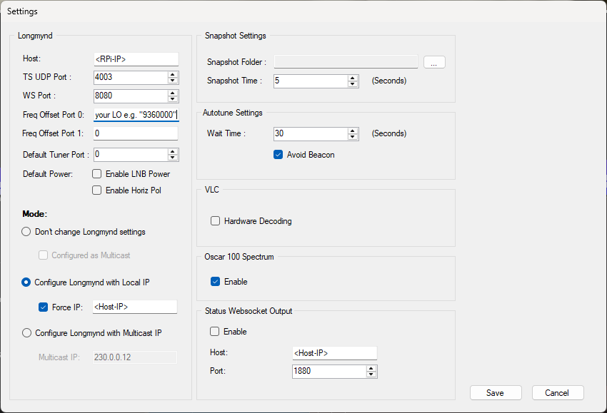
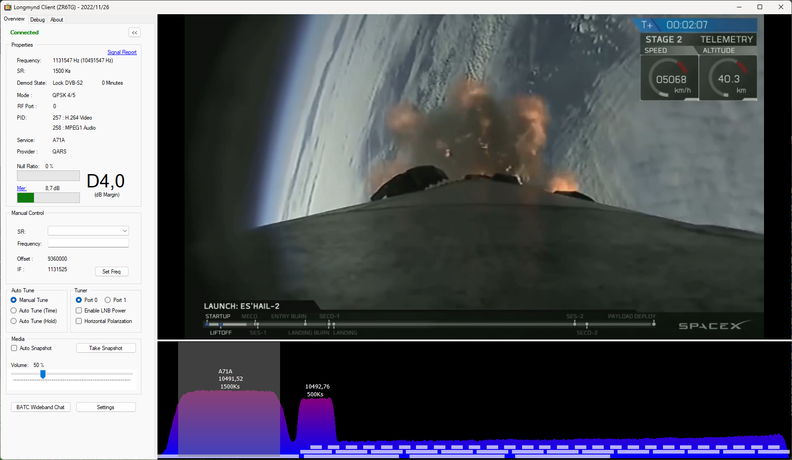
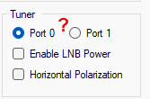

# Bringing Up: Longmynd-Server in Betrieb nehmen und prüfen

Merkblatt für Betrieb, Client-Einstellungen und Fehlersuche. Voraussetzung:
Installation nach [HowTo_Install.md](HowTo_Install.md) ist abgeschlossen und
der Dienst `longmynd` läuft.

## 1. Schnellcheck (Pi)

```bash
systemctl status longmynd                  # active (running)?
journalctl -u longmynd -n 30 --no-pager    # Log, Zeile "Web interface enabled: Port 8080"
ss -ltn | grep 8080                        # lauscht der Web-Port?
pgrep -a longmynd                          # läuft nur eine Instanz?
lsusb | grep 0403                          # MiniTiouner erkannt?
```

Vom PC: Browser `http://<RPi-IP>:8080`. Dort stehen Lock-Status, MER,
RF-Pegel, Konstellation sowie Dienst- und Providername.

## 2. Wege der Daten

| Verbindung | Weg | Port | Genutzt von |
|---|---|---|---|
| Steuerung (Frequenz, SR, LNB, TS-Ziel, RF-Port) | WebSocket | 8080 (TCP) | Longmynd Client, OpenTuner, Web-UI |
| Status (Lock, MER, Pegel, Dienstname) | WebSocket | 8080 (TCP) | Longmynd Client, OpenTuner, Web-UI |
| Video (MPEG-TS) | UDP | frei, hier 4003 | Player auf dem PC, Ziel setzt der Client |
| UDP-Status | UDP | 4002 | **von keinem getesteten Programm genutzt** |

Belege aus den Tests: Der Client belegt nur UDP 4003, nicht 4002
(`Get-NetUDPEndpoint`), und seine Statusdaten stehen als JSON
`"type": "status"` in seinem Debug-Log (Monitor-WebSocket). Für andere
Programme habe ich den UDP-Status nicht geprüft.

Das Video-Ziel richtet der Client beim Verbinden selbst ein
(Befehl `U<IP>:<Port>`). Deshalb stören die `127.0.0.1`-Startwerte im
Dienst nicht.

## 3. Longmynd Client (ZR6TG) einstellen

| Einstellung | Wert |
|---|---|
| Host | `<RPi-IP>` |
| TS UDP Port | `4003` |
| WS Port | `8080` |
| Freq Offset Port 0 | `9360000` (LO in kHz) |
| Modus | **Configure Longmynd with Local IP** |
| Force IP | `<PC-IP>` (IP des PCs) |
| Hardware Decoding (VLC) | zum Test **aus** |
| Status Websocket Output | **aus**, solange nichts auf `:1880` lauscht |



*Dialog „Settings" des Longmynd Clients. Statt `<RPi-IP>` und `<Host-IP>`
tragen Sie die IP des Pi bzw. des PCs ein.*

**Force IP ist wichtig.** Der PC hat mehrere Adressen (echte Karte, TAP,
Hyper-V). Ohne Force IP wählt der Client mitunter eine falsche, im Log
erkennbar an `Attempt to change longmynd TS to 169.254...` oder
`172.25...`. Mit Force IP folgt danach `Configuring as <PC-IP>:4003`.

**Status Websocket Output** verbindet den Client mit einem eigenen Dienst auf
`ws://<Host>:1880/ws/datvstatus`. Läuft dort nichts, gibt es endlos
`Websocket was closed by remote, trying to reconnect...`. Für den Empfang
wird die Funktion nicht gebraucht.

### Gute Anzeichen im Client-Log (`debug.txt`)

```
Success: Control WS Open
Success: Monitor WS Open
Configuring as <PC-IP>:4003
Media Player Playing
New Callsign: ...
```

So sieht ein laufender Empfang im Client aus (Lock DVB-S2, Video und
Spektrum):



### Tuner-Bereich: Port und LNB-Power



Im Bereich *Tuner* des Clients stehen *Port 0 / Port 1*, *Enable LNB Power*
und *Horizontal Polarization*.

**Einschränkung beim MiniTiouner Pro:** *Port 1* und *Enable LNB Power*
funktionieren im Longmynd Client (ZR6TG) in der Version 2022/11/26 nicht.
Es ließ sich nicht zwischen LNB A und LNB B umschalten. Vermutlich
unterstützt diese Client-Version nur einen MiniTiouner mit einem LNB. Das
ist eine Vermutung, der Quellcode des Clients liegt nicht vor.

Dafür gibt es hier keine Abhilfe im Client. Für zwei LNB oder mehrere Tuner
nutzen Sie OpenTuner (Abschnitt 4).

## 4. OpenTuner

- Control Interface: **WebSocket (M0DNY)**, `<RPi-IP>`, Port `8080`.
- TS Address: feste PC-IP statt `auto`, TS Port gleich dem Port, den der
  Player belegt.
- Haken **„Test mode: only receive the TS, no Longmynd control"** muss
  **aus** sein, sonst steuert OpenTuner nicht.
- Stand der Tests: Status und Steuerung funktionieren (mit PR #2), das
  eingebaute Videobild in OpenTuner wurde nicht abschließend geklärt. Der
  Longmynd Client zeigt das Bild.

Client und OpenTuner nicht gleichzeitig benutzen: beide setzen das
TS-Ziel um, der zuletzt verbundene gewinnt.

## 5. Video in VLC oder mpv

```
vlc udp://@:4003
mpv udp://@:4003
```

Der Pi sendet an das Ziel, das zuletzt per WebSocket gesetzt wurde. Das
Bild erscheint erst nach ein paar Sekunden und nur bei Lock.

**Verhalten bei zwei Empfängern auf demselben Port (Windows):** Wenn ein
Player an eine **feste Adresse** gebunden ist (`udp://@<PC-IP>:4003`),
bekommt er den Strom vor einem Socket, der an alle Adressen gebunden ist.
Der Client verliert den Strom, bis dieser Player beendet wird. Bei
`udp://@:4003` binden beide gleich allgemein, der erste Besitzer behält den
Strom. Gleichzeitiges Ansehen in zwei Playern geht so nicht (Multicast wäre
der Weg, nicht getestet).

## 6. Fehlersuche

| Symptom | Prüfen / Abhilfe |
|---|---|
| Web-UI nicht erreichbar | `ss -ltn \| grep 8080`. Fehlt die Log-Zeile `Web interface enabled`: Binary veraltet. `make clean && make`, Dienst neu starten. |
| `-W 8080` wird ohne Fehler ignoriert | Longmynd überspringt unbekannte Optionen still. Binary neu bauen (siehe oben) und Log prüfen. |
| `ERROR: Failed to open fifo` beim Start | `-i`/`-I` fehlen, FIFO-Datei existiert nicht. Mit `-i 127.0.0.1 4003 -I 127.0.0.1 4002` starten. |
| `No-data timeout, re-init config` | Kein DVB-S/S2-Signal auf dieser ZF/SR. ZF aus Empfangsfrequenz minus LO prüfen. Kein Installationsfehler. |
| Status im Client ohne sinnvolle Werte | PR #2 (`json_object_new_int`) fehlt, `git log --oneline -3` und `grep -c json_object_new_int web/web.c`. |
| Statuszeile OK, kein Bild im Client | TS-Ziel/IP prüfen (Force IP), Hardware Decoding aus, VLC-Bitbreite zum Client passend, Windows-Firewall für UDP. Gegenprobe: `vlc udp://@:4003` (Client vorher schließen). |
| Bild nur in VLC, nicht im Client | Eingebauter Player des Clients/OpenTuners. Steuerung weiter über den Client, Bild in VLC. |
| `longmynd` startet im Dienst nicht | `journalctl -u longmynd -n 50`. Läuft noch ein manuell gestartetes Longmynd? MiniTiouner angesteckt? |
| Lock-Verluste oder USB-Resets | Netzteil 5V/3A, USB-3.0-Port, andere Last vom Port entfernen, `dmesg \| tail -30`. |

### Prüfen, was der Pi sendet

```bash
sudo apt install -y tcpdump
sudo tcpdump -ni any udp -c 10
```

Erwartet im Betrieb mit Client: `<RPi-IP>.xxxx > <PC-IP>.4003`.

### Prüfen, was am PC lauscht (PowerShell)

```powershell
Get-NetUDPEndpoint -LocalPort 4002,4003 -ErrorAction SilentlyContinue |
  ForEach-Object { [pscustomobject]@{Port=$_.LocalPort; Prozess=(Get-Process -Id $_.OwningProcess).ProcessName} }
```

### Wireshark

- Auf der Karte mit der echten Netzwerkadresse (hier **Ethernet**,
  Realtek, `<PC-IP>`) mitschneiden, nicht auf Loopback, TAP oder
  vEthernet.
- Erscheint die Karte nicht in der Liste: in den Adapter-Eigenschaften
  muss „Npcap Packet Driver (NPCAP)" angehakt sein, sonst Npcap neu
  installieren.
- Filter: `udp.port == 4003` (Video), `ip.addr == <RPi-IP>`.
- Der UDP-Status auf 4002 erscheint am PC nur, wenn Longmynd mit
  `-I <PC-IP> 4002` läuft.

## 7. Startparameter ändern

```bash
sudo nano /etc/systemd/system/longmynd.service      # ExecStart anpassen
sudo systemctl daemon-reload
sudo systemctl restart longmynd
```

Im Normalbetrieb nicht nötig: Frequenz, Symbolrate, LNB-Spannung, RF-Port
und TS-Ziel setzen Client oder OpenTuner selbst.

Ist das Dateisystem schreibgeschützt (HowTo_Install.md, Abschnitt 11),
vorher den Schutz abschalten und nach der Änderung wieder aktivieren.

Beispiele:
- unterer Eingang: `-w` vor die Frequenz
- LNB-Spannung dauerhaft: `-p h` (18 V) oder `-p v` (13 V)

## 8. Merkpunkte

- **ZF-Frequenz in kHz**, nicht die Empfangsfrequenz. Bake 10491,5 MHz:
  mit LO 9360 MHz `10491,5 − 9360 = 1131,5 MHz = 1131500 kHz`, mit
  LO 9750 MHz `10491,5 − 9750 = 741,5 MHz = 741500 kHz`.
- Verwendet wird der Fork `DH1RK/longmynd` (`philcrump/longmynd` plus PR #2
  von dl1rf). Das BATC-Original und `F5OEO`-Forks haben kein Web-UI und
  taugen für diesen Zweck nicht.
- Updates kommen per `git pull` aus dem Fork.
- MiniTiouner immer an einen USB-3.0-Port, Netzteil 5V/3A.
- Ein Longmynd-Prozess pro MiniTiouner. Dienst stoppen, bevor man von
  Hand startet: `sudo systemctl stop longmynd`.

## 9. Offene Punkte

- Bild im eingebauten Player von OpenTuner nicht abschließend geklärt
  (Status und Steuerung laufen).
- Nicht getestet: Multicast-Betrieb, Verhalten des Web-UI bei sehr
  schwachem Signal, Verwendung des UDP-Status durch andere Programme.
- PR #2 ist bei Phil (`philcrump/longmynd`) beim Schreiben dieser Anleitung
  noch offen. Der Fork enthält den Fix bereits. Neuerungen von Phil müssen
  im Fork nachgezogen werden.
