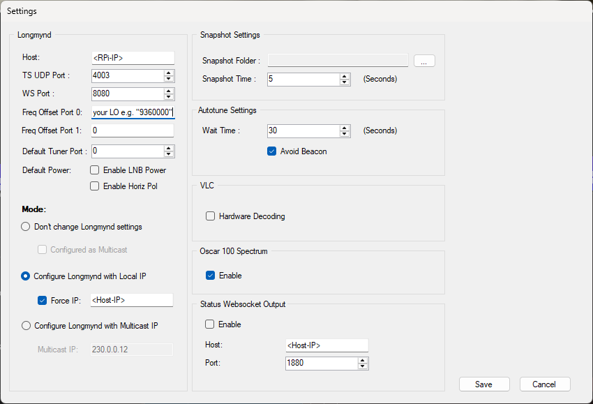
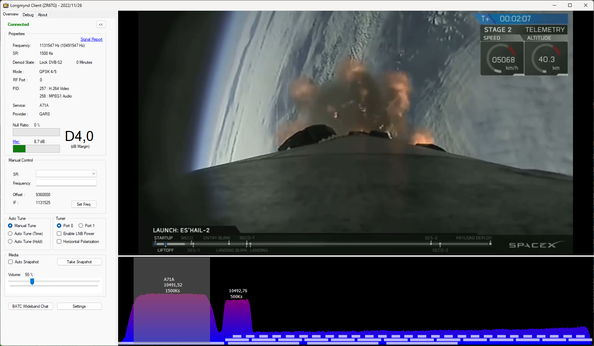
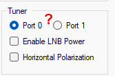

# Bringing Up: Commissioning and Checking the Longmynd Server

Cheat sheet for operation, client settings and troubleshooting. Prerequisite:
the installation according to [HowTo_Install_EN.md](HowTo_Install_EN.md) is
complete and the `longmynd` service is running.

## 1. Quick check (Pi)

```bash
systemctl status longmynd                  # active (running)?
journalctl -u longmynd -n 30 --no-pager    # log, line "Web interface enabled: Port 8080"
ss -ltn | grep 8080                        # is the web port listening?
pgrep -a longmynd                          # only one instance running?
lsusb | grep 0403                          # MiniTiouner detected?
```

From the PC: browser `http://<RPi-IP>:8080`. It shows lock status, MER,
RF level, constellation as well as service and provider name.

## 2. Data paths

| Connection | Path | Port | Used by |
|---|---|---|---|
| Control (frequency, SR, LNB, TS destination, RF port) | WebSocket | 8080 (TCP) | Longmynd Client, OpenTuner, web UI |
| Status (lock, MER, level, service name) | WebSocket | 8080 (TCP) | Longmynd Client, OpenTuner, web UI |
| Video (MPEG-TS) | UDP | free, here 4003 | Player on the PC, destination set by the client |
| UDP status | UDP | 4002 | **not used by any tested program** |

Evidence from the tests: The client only occupies UDP 4003, not 4002
(`Get-NetUDPEndpoint`), and its status data appears as JSON
`"type": "status"` in its debug log (monitor WebSocket). The UDP status was
not checked for other programs.

The client sets up the video destination itself when connecting
(command `U<IP>:<Port>`). That is why the `127.0.0.1` start values in the
service do no harm.

## 3. Configure the Longmynd Client (ZR6TG)

| Setting | Value |
|---|---|
| Host | `<RPi-IP>` |
| TS UDP Port | `4003` |
| WS Port | `8080` |
| Freq Offset Port 0 | `9360000` (LO in kHz) |
| Mode | **Configure Longmynd with Local IP** |
| Force IP | `<PC-IP>` (IP of the PC) |
| Hardware Decoding (VLC) | **off** for testing |
| Status Websocket Output | **off** as long as nothing listens on `:1880` |



*"Settings" dialog of the Longmynd Client. Enter the IP of the Pi and of the
PC instead of `<RPi-IP>` and `<Host-IP>`.*

**Force IP is important.** The PC has several addresses (real card, TAP,
Hyper-V). Without Force IP the client sometimes picks a wrong one, visible
in the log as `Attempt to change longmynd TS to 169.254...` or
`172.25...`. With Force IP, `Configuring as <PC-IP>:4003` follows.

**Status Websocket Output** connects the client to a separate service on
`ws://<Host>:1880/ws/datvstatus`. If nothing runs there, you get an endless
`Websocket was closed by remote, trying to reconnect...`. The function is
not needed for reception.

### Good signs in the client log (`debug.txt`)

```
Success: Control WS Open
Success: Monitor WS Open
Configuring as <PC-IP>:4003
Media Player Playing
New Callsign: ...
```

This is what a running reception looks like in the client (lock DVB-S2,
video and spectrum):



### Tuner area: port and LNB power



The *Tuner* area of the client contains *Port 0 / Port 1*, *Enable LNB Power*
and *Horizontal Polarization*. The picture is filed as "not functional with
the MiniTiouner" (file name `NotFunctionalLNB_MinitiounerPro.png`), the exact
statement still has to be confirmed and added.

## 4. OpenTuner

- Control Interface: **WebSocket (M0DNY)**, `<RPi-IP>`, port `8080`.
- TS Address: fixed PC IP instead of `auto`, TS Port equal to the port the
  player uses.
- The checkbox **"Test mode: only receive the TS, no Longmynd control"** must
  be **off**, otherwise OpenTuner does not control anything.
- State of the tests: status and control work (with PR #2), the built-in
  video picture in OpenTuner was not conclusively clarified. The
  Longmynd Client shows the picture.

Do not use Client and OpenTuner at the same time: both set the
TS destination, the one connected last wins.

## 5. Video in VLC or mpv

```
vlc udp://@:4003
mpv udp://@:4003
```

The Pi sends to the destination that was set last via WebSocket. The
picture appears only after a few seconds and only with lock.

**Behavior with two receivers on the same port (Windows):** If a player is
bound to a **fixed address** (`udp://@<PC-IP>:4003`), it gets the stream
before a socket bound to all addresses. The client loses the stream until
that player is closed. With `udp://@:4003` both bind equally generally, and
the first owner keeps the stream. Watching simultaneously in two players does
not work this way (multicast would be the way, not tested).

## 6. Troubleshooting

| Symptom | Check / remedy |
|---|---|
| Web UI not reachable | `ss -ltn \| grep 8080`. If the log line `Web interface enabled` is missing: binary outdated. `make clean && make`, restart the service. |
| `-W 8080` is ignored without error | Longmynd silently skips unknown options. Rebuild the binary (see above) and check the log. |
| `ERROR: Failed to open fifo` at start | `-i`/`-I` missing, FIFO file does not exist. Start with `-i 127.0.0.1 4003 -I 127.0.0.1 4002`. |
| `No-data timeout, re-init config` | No DVB-S/S2 signal on this IF/SR. Check IF = receive frequency minus LO. Not an installation error. |
| Status in the client without sensible values | PR #2 (`json_object_new_int`) missing, `git log --oneline -3` and `grep -c json_object_new_int web/web.c`. |
| Status line OK, no picture in the client | Check TS destination/IP (Force IP), hardware decoding off, VLC bit width matching the client, Windows firewall for UDP. Counter-test: `vlc udp://@:4003` (close the client first). |
| Picture only in VLC, not in the client | Built-in player of the Client/OpenTuner. Keep controlling via the client, picture in VLC. |
| `longmynd` does not start in the service | `journalctl -u longmynd -n 50`. Is a manually started Longmynd still running? MiniTiouner plugged in? |
| Lock losses or USB resets | Power supply 5V/3A, USB 3.0 port, remove other load from the port, `dmesg \| tail -30`. |

### Check what the Pi sends

```bash
sudo apt install -y tcpdump
sudo tcpdump -ni any udp -c 10
```

Expected in operation with the client: `<RPi-IP>.xxxx > <PC-IP>.4003`.

### Check what listens on the PC (PowerShell)

```powershell
Get-NetUDPEndpoint -LocalPort 4002,4003 -ErrorAction SilentlyContinue |
  ForEach-Object { [pscustomobject]@{Port=$_.LocalPort; Process=(Get-Process -Id $_.OwningProcess).ProcessName} }
```

### Wireshark

- Capture on the card with the real network address (here **Ethernet**,
  Realtek, `<PC-IP>`), not on loopback, TAP or vEthernet.
- If the card does not appear in the list: "Npcap Packet Driver (NPCAP)"
  must be ticked in the adapter properties, otherwise reinstall Npcap.
- Filter: `udp.port == 4003` (video), `ip.addr == <RPi-IP>`.
- The UDP status on 4002 only appears on the PC if Longmynd runs with
  `-I <PC-IP> 4002`.

## 7. Changing start parameters

```bash
sudo nano /etc/systemd/system/longmynd.service      # adjust ExecStart
sudo systemctl daemon-reload
sudo systemctl restart longmynd
```

Not necessary in normal operation: frequency, symbol rate, LNB voltage, RF
port and TS destination are set by the client or OpenTuner themselves.

If the file system is write-protected (HowTo_Install_EN.md, section 11),
switch the protection off first and enable it again after the change.

Examples:
- lower input: `-w` before the frequency
- permanent LNB voltage: `-p h` (18 V) or `-p v` (13 V)

## 8. Key points

- **IF frequency in kHz**, not the receive frequency. Beacon 10491.5 MHz:
  with LO 9360 MHz `10491.5 − 9360 = 1131.5 MHz = 1131500 kHz`, with
  LO 9750 MHz `10491.5 − 9750 = 741.5 MHz = 741500 kHz`.
- The fork `DH1RK/longmynd` is used (`philcrump/longmynd` plus PR #2 by
  dl1rf). The BATC original and `F5OEO` forks have no web UI and are
  unsuitable for this purpose.
- Updates come via `git pull` from the fork.
- Always connect the MiniTiouner to a USB 3.0 port, power supply 5V/3A.
- One Longmynd process per MiniTiouner. Stop the service before starting
  by hand: `sudo systemctl stop longmynd`.

## 9. Open points

- Picture in the built-in player of OpenTuner not conclusively clarified
  (status and control work).
- Not tested: multicast operation, behavior of the web UI with a very
  weak signal, use of the UDP status by other programs.
- PR #2 is still open at Phil's (`philcrump/longmynd`) at the time of
  writing. The fork already contains the fix. News from Phil have to be
  pulled into the fork.
